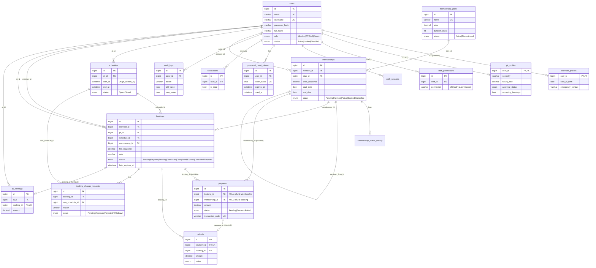

# ERD – Fitness Center Membership & PT Booking App

Sơ đồ Mermaid (xem trực tiếp trên GitHub/GitLab hoặc dán vào https://mermaid.live để xuất PNG).

## Khởi tạo database cho dự án

Import [schema.sql](../database/schema.sql) vào MySQL/MariaDB để tạo database `fitness_center` trống, rồi import [seed.sql](../database/seed.sql) để thêm tài khoản và dữ liệu mẫu. PHP mặc định kết nối tới `127.0.0.1:3306`, user `root`, mật khẩu rỗng. Đặt `DB_HOST`, `DB_PORT`, `DB_NAME`, `DB_USER` hoặc `DB_PASS` nếu môi trường của bạn dùng cấu hình khác.

Các view trong `schema.sql` cung cấp tên trường mà giao diện PHP hiện dùng. Dữ liệu được lưu trong các bảng ở sơ đồ dưới đây.

## Ràng buộc quan trọng đã cài ở tầng DB

| Quy tắc nghiệp vụ | Cách thực hiện trong schema |
|---|---|
| Không có 2 Booking cùng chiếm 1 slot PT | `bookings.active_schedule_id` (cột sinh) + `UNIQUE` – chỉ tính Booking ở trạng thái AwaitingPayment/Pending/Confirmed/Completed |
| Không có 2 Payment Pending cho cùng Booking/Membership | `payments.pending_booking_id`, `pending_membership_id` (cột sinh) + `UNIQUE` |
| Payment thuộc đúng 1 Membership **hoặc** 1 Booking | `CHECK ck_payments_one_target` |
| Chống hoàn tiền trùng | `refunds.payment_id` `UNIQUE` |
| Thu nhập PT ghi đúng 1 lần | `pt_earnings.booking_id` `UNIQUE` |
| Mỗi Member chỉ có 1 Membership Active | `memberships.active_member_id` (cột sinh) + `UNIQUE` |
| Mỗi Booking chỉ có 1 yêu cầu đổi lịch đang chờ | `booking_change_requests.pending_booking_id` + `UNIQUE` |
| Token đặt lại mật khẩu dùng 1 lần | `used_at` + `token_hash UNIQUE` (backend kiểm tra `used_at IS NULL`) |
| Khung giờ hợp lệ, không trùng | `CHECK start_at < end_at`, `UNIQUE(pt_id, start_at)` |
| Giữ nguyên lịch sử khi sửa gói | `memberships.*_snapshot` |

## Giả định thiết kế (cần cả nhóm thống nhất)

1. **Schedule = khung giờ cố định** (mặc định 1 tiếng) do PT tạo; 1 Booking chiếm đúng 1 Schedule. Nếu nhóm muốn đặt thời lượng linh hoạt (90 phút, 2 giờ…) thì cần đổi sang chống chồng lấn theo khoảng thời gian ở tầng Service.
2. **Giờ lưu DB là UTC**; frontend/backend chuyển sang giờ Việt Nam (UTC+7) khi hiển thị.
3. **Tối đa 1 Membership Active/Member**; gia hạn tạo Membership mới (`renewed_from_id`) và chỉ Active khi Payment Success.
4. **Cột sinh (generated column)** thay cho partial unique index vì MySQL/MariaDB không hỗ trợ partial index.
5. Quyền Staff lưu dạng chuỗi trong `staff_permissions.permission` (REPORT_VIEW, BOOKING_MANAGE, PAYMENT_VIEW, MEMBERSHIP_MANAGE, PT_MANAGE); danh sách chính thức do TV4 và TV3 chốt cùng middleware.
